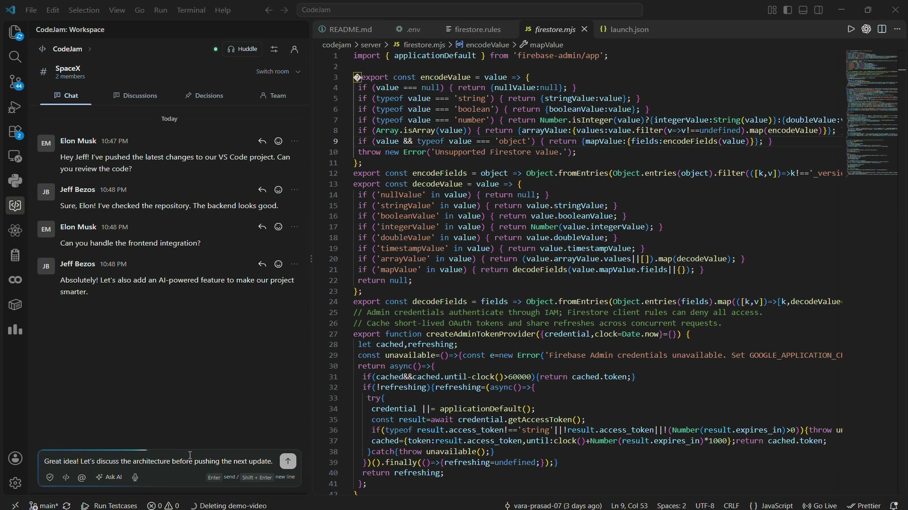
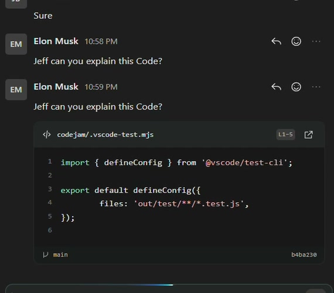
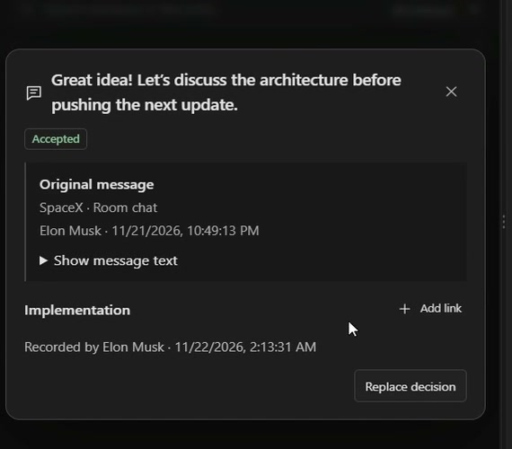

# CodeJam

**Team chat, shared code, and decisions inside VS Code.**

Built for the **NexConn Hackathon**. CodeJam gives a development team a shared conversation space connected to the project they are working on.

[Install for VS Code](https://marketplace.visualstudio.com/items?itemName=CodeJam.codejam-workspace) · [Try the demo workflow](#a-quick-demo-for-judges) · [NexConn integration](#how-we-use-nexconn)



<p align="center"><sub>Team chat alongside the code. Screenshots use fictional demo accounts.</sub></p>

<table>
  <tr>
    <td width="50%" valign="top">
      <a href="codejam/docs/images/shared-code.jpg"></a>
      <br><strong>Share the code, with its context.</strong><br>
      A reference keeps the selected excerpt, file, branch, and revision together.
    </td>
    <td width="50%" valign="top">
      <a href="codejam/docs/images/decisions.jpg"></a>
      <br><strong>Keep the reasoning easy to find.</strong><br>
      Saved decisions retain the original conversation and implementation links.
    </td>
  </tr>
</table>

## The problem

A teammate shares a function in chat. Someone else cannot open it because their checkout lives in a different folder or uses a fork. The conversation moves to a call, the team agrees on a fix, and the reasoning disappears into message history.

Developers then spend time finding the right file, repeating context, and reconstructing decisions across their editor, chat, and calls.

CodeJam brings that workflow into the editor: **share the code, discuss the problem, talk when needed, and preserve the decision with its original context.**

## What you can do

- **Chat with your project team.** Create an invitation-only room, exchange messages, mention teammates, and load earlier conversations.
- **Share code that teammates can open.** References include a relative filename, line range, branch, commit, and the selected excerpt. Each teammate links their own local checkout or fork. Moved lines are matched by content; missing or changed code opens as a read-only shared snapshot.
- **Give discussions a home.** Start a thread from a message, reply, and resolve or reopen it.
- **Keep the reasoning behind a decision.** Propose, review, accept, and replace decisions; retain the source discussion and attach implementation links.
- **Use voice and translation.** Send a recorded voice message, join a live audio huddle, or privately translate a message into English, Hindi, or Telugu.
- **Ask a private AI assistant.** Type `@agent` and choose whether to include selected code, recent messages, or Git diff. Publish an answer only through **Share with room**.

## How we use NexConn

NexConn powers the communication layer of CodeJam.

| NexConn integration | What it does in CodeJam | Implementation |
| --- | --- | --- |
| **Chat SDK** (`@nexconn/chat`) | Connects authenticated users to group channels, delivers messages live, loads cloud history, and transports shared code references and mentions. | [Chat bridge](codejam/src/nexconnClient.ts) |
| **Voice messages through Chat** | Uploads and sends recorded audio using `Helper.createSendHDVoiceMessageParams` and `GroupChannel.sendMediaMessage`; receives voice metadata for playback. | [Voice transport](codejam/src/nexconnClient.ts), [local recorder](codejam/src/voice.ts) |
| **Translation through Chat** | Uses automatic source-language detection and `translateMessages` to display a private translation. The original room message stays intact. | [Translation integration](codejam/src/translation.ts) |
| **Call SDK** (`@nexconn/call`) | Provides live group audio huddles with microphone controls. Calls run in a browser page opened from the extension. | [Call page](codejam/src/callPage.mts) |
| **Server APIs** | Issues user access tokens and creates, joins, leaves, transfers, and dismisses group channels. The application secret stays on the backend. | [NexConn server integration](codejam/server/nexconn.mjs) |

The project also includes `@nexconn/engine` as a runtime dependency. Chat and Call provide the application-facing connection APIs.

**Supporting services:** Firebase Authentication handles sign-in; Firestore stores room membership, discussion and decision snapshots, reactions, presence, and call metadata. Gemini powers the optional private Agent. Chat messages, voice-message transport, translation, and live calls use the NexConn integrations above.

## A quick demo for judges

Use **two VS Code instances with different CodeJam accounts**, ideally on two laptops. Both must use the same backend.

1. Open a project, run **CodeJam: Open Workspace**, and sign in with email/password or Google.
2. Create a room in the first instance. Copy its invitation and join from the second.
3. Send a message. Select a function in the editor, right-click, choose **Share Selection with Team**, and send it.
4. In the second instance, choose **Link project folder** if prompted, then **Open in editor** on the shared code. Different local directory names are supported. Change or remove the local excerpt and try again to see the saved-snapshot fallback.
5. Open the message's **More actions → Open discussion**. Reply, propose a decision, then review and accept it.
6. Try **Translate** from a text message's actions, or open **Team → Start audio huddle** and allow microphone access in the browser. Invite a teammate before starting a group huddle.
7. Type `@agent Explain this function`. Enable **Selected code** in **Agent context** when the question needs it. The answer remains private until you choose **Share with room**.

Use **CodeJam: Open Full View** for a larger demo window.

## Setup on Windows, macOS, and Linux

### Requirements

- Desktop **VS Code 1.146.0 or later**, as required by the extension manifest.
- **Node.js 24 (24.15.0 or later)**, or **Node.js 22 (22.22.2 or later)**, and npm. These versions satisfy the locked development dependencies.
- Git for cloning this repository and reading project history.
- Internet access and a browser with microphone support for huddles.

The extension source uses the same build process on all three operating systems. Native voice-message recording has an additional platform requirement described below.

### Windows — PowerShell

```powershell
git clone https://github.com/vara-prasad-07/CodeJam.git
cd CodeJam/codejam
npm ci
New-Item -ItemType Directory -Force ../artifacts | Out-Null
npm run vsix
```

### macOS — Terminal

```bash
git clone https://github.com/vara-prasad-07/CodeJam.git
cd CodeJam/codejam
npm ci
mkdir -p ../artifacts
npm run vsix
```

### Linux — Terminal

```bash
git clone https://github.com/vara-prasad-07/CodeJam.git
cd CodeJam/codejam
npm ci
mkdir -p ../artifacts
npm run vsix
```

### Install and connect

1. In VS Code, open **Extensions → … → Install from VSIX**.
2. Select the generated `codejam-workspace-<version>.vsix` in the repository's `artifacts` folder. Reload VS Code if prompted.
3. Open and trust your project folder, click the CodeJam activity icon, and sign in.
4. Create or join a room. Link your local project folder when prompted.

By default, the extension connects to **`https://codejam-vdmp.onrender.com`**. Using this hosted backend requires no provider keys or local server setup. An existing `codejam.apiUrl` setting overrides that default.

The hosted service may take time to wake after inactivity. If startup times out, wait briefly and use **Reconnect**. The install instructions above build the extension locally; generated VSIX files are excluded from Git.

### Voice recording on each platform

**Browser audio huddles and recorded voice messages use different capture paths.** Huddles request the browser's microphone permission. Voice messages use a small native recorder started by the desktop extension only when you press Record.

| Platform | Native voice-message recorder |
| --- | --- |
| Windows x64 | The repository includes a Windows ia32 helper that the extension can use on x64. A local Windows x64 microphone smoke test is documented in the recorder notes. |
| Windows ARM64 | Build or bundle a matching Windows ARM64 helper. |
| macOS Intel / Apple silicon | Build or bundle a matching `darwin-x64` / `darwin-arm64` helper. |
| Linux x64 / ARM64 | Build or bundle a matching `linux-x64` / `linux-arm64` helper. |

To build a helper, run the following **inside `codejam`**, then run `npm run vsix` again:

```bash
npm run build:recorder
npm run vsix
```

- **Windows:** run the build from an MSVC developer shell with the C compiler available.
- **macOS:** install Xcode Command Line Tools so `cc` is available.
- **Linux:** install a C toolchain; on Ubuntu/Debian this is provided by `build-essential`.

The build generates the executable and its checksum for your current OS/CPU. A [CI workflow](.github/workflows/native-recorder.yml) also defines builds for all six Windows/macOS/Linux x64/ARM64 targets. See the [recorder build notes](codejam/native/README.md) for archive layout and compiler options.

macOS/Linux microphone behavior still needs testing on real devices. A missing helper disables voice recording with an explanation; it does not block text chat. Native recording currently requires a local desktop extension host, rather than WSL, SSH, or Codespaces. Grant microphone permissions when requested.

<details>
<summary><strong>Optional: run your own backend</strong></summary>

### 1. Configure the services

- Create a NexConn application with Chat and Call access. Enable translation for the languages you want to demonstrate. Match the application's region: `SG`, `NA`, or `SA`.
- Use a dedicated Firebase project. Enable **Email/Password** and **Google** in Firebase Authentication, create the Firestore database, and add `localhost` to the authorized sign-in domains for local Google sign-in.
- Give the backend Firebase Admin/IAM access. Keep its service-account JSON outside the repository. Follow the [Firestore setup and access guide](codejam/docs/FIRESTORE_SECURITY.md).
- Add a Gemini API key if you want to demonstrate Agent. Chat and calls do not require Gemini.

### 2. Create the environment file

Run inside `codejam`:

| Shell | Command |
| --- | --- |
| Windows PowerShell | `Copy-Item server/.env.example server/.env` |
| macOS / Linux | `cp server/.env.example server/.env` |

Fill in the ignored `server/.env` using the [environment template](codejam/server/.env.example).

| Variable | Purpose |
| --- | --- |
| `NEXCONN_APP_KEY` | NexConn application key. |
| `NEXCONN_APP_SECRET` | Backend-only secret for signed token and channel-management requests. |
| `NEXCONN_REGION` | `SG`, `NA`, or `SA`, matching your NexConn application. |
| `apiKey`, `authDomain`, `projectId`, `appId` | Firebase web configuration. Equivalent `FIREBASE_API_KEY`, `FIREBASE_AUTH_DOMAIN`, `FIREBASE_PROJECT_ID`, and `FIREBASE_APP_ID` names are also supported. |
| `GOOGLE_APPLICATION_CREDENTIALS` | Absolute path to the private Firebase service-account JSON. On Windows, a path such as `C:/private/firebase-service-account.json` avoids backslash escaping. |
| `GEMINI_API_KEY` | Optional; enables private Agent answers. |
| `GEMINI_MODEL` | Optional model override; otherwise the backend discovers an available text model. |
| `HOST`, `PORT` | Local defaults: `127.0.0.1`, `3000`. |
| `CODEJAM_PUBLIC_URL` | For local browser sign-in and calls, use `http://localhost:3000`; for deployment, use your public HTTPS origin. |

### 3. Build and start

```bash
npm run compile
npm run server
```

Keep that terminal running. In each VS Code instance, set:

```json
{
  "codejam.apiUrl": "http://127.0.0.1:3000"
}
```

Restart the backend after changing `.env`. Teammates on other computers need a reachable HTTPS deployment and the same `codejam.apiUrl`; `localhost` addresses only the computer running it.

For debugging, open the outer `CodeJam` folder in VS Code and launch **Run Extension**. The checked-in F5 configuration and **CodeJam - Two People** helper currently use Windows-specific paths; the packaged VSIX installation above is the common path for all three operating systems.

The backend requires working Firebase and NexConn services. Provider keys and service-account files stay on the backend and must not be committed or included in a VSIX. A `/health` response confirms server liveness; sign in and create/join a room to verify database and provider access.

</details>

## Project structure

```text
CodeJam/
├── README.md                 # Hackathon overview and setup
├── .github/workflows/        # Native-recorder build matrix
└── codejam/
    ├── src/                  # VS Code host, NexConn bridge, calls, translation, Agent
    ├── media/                # Extension UI and intro assets
    ├── server/               # Sessions, NexConn server APIs, Firebase, Gemini
    ├── native/               # Local microphone recorder and platform binaries
    ├── tests/                # Extension-host, SDK, UI and reference tests
    └── docs/                 # Deployment and implementation notes
```

## Verification

Run inside `codejam`:

```bash
npm run compile
npm test
```

The automated suite covers room access, NexConn SDK bridging, private translations, voice-message transport, AI context permissions, decisions, checkout mapping, snapshot fallback, startup, and UI flows. Provider calls in the base suite use test doubles.

`npm run test:nexconn` and `npm run test:project` are optional live integration checks. They require configured credentials and create temporary provider resources, consuming service quota. Live microphone calls, Google browser sign-in, and platform permissions also need a manual two-person check.

## Data and privacy

Shared excerpts and messages travel through NexConn. Firestore retains room metadata and discussion/decision snapshots. Agent sends your question and enabled context to Gemini. Local checkout mappings remain in VS Code workspace state; session tokens use VS Code SecretStorage.

Review the [privacy disclosure](codejam/PRIVACY.md) and [security notes](codejam/SECURITY.md) before sharing private project code. For detailed product usage, see the [extension README](codejam/README.md).

## License

[MIT](codejam/LICENSE.txt). Third-party SDKs and services retain their own licenses and terms; see [third-party notices](codejam/THIRD_PARTY_NOTICES.md).
